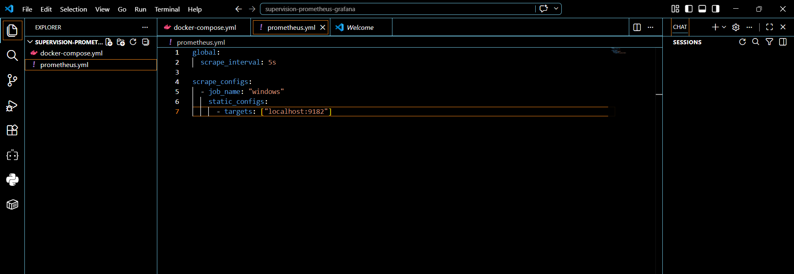
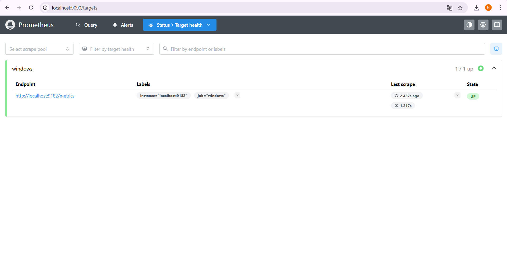
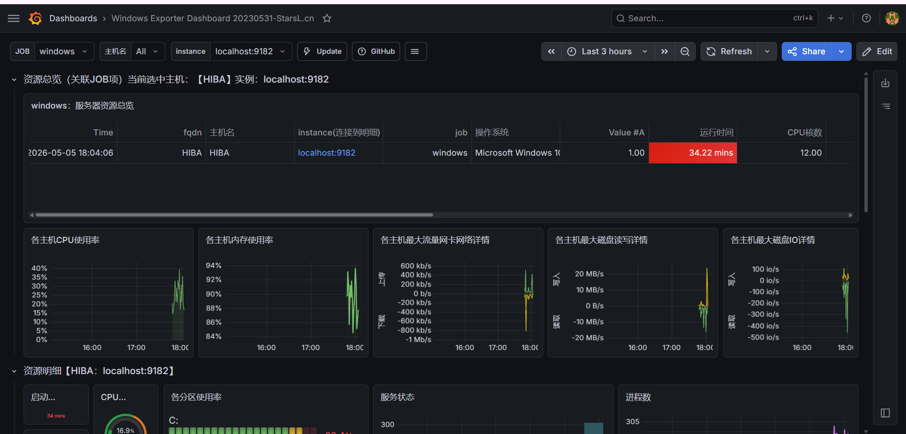
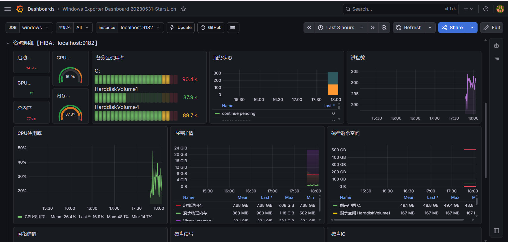

# Supervision Windows avec Prometheus & Grafana

Projet du module **Supervision** (EMSI Rabat, 2025-2026), réalisé en binôme : une chaîne de supervision qui collecte en temps réel les métriques d'une machine Windows (CPU, mémoire, disque, réseau, processus), les stocke dans **Prometheus** et les affiche dans des tableaux de bord **Grafana**.

## Objectif

Surveiller en continu l'état d'une machine Windows, repérer les ressources en situation critique et proposer des seuils d'alerte. C'est la même logique de supervision que celle utilisée dans les équipes SOC et IT Ops.

## Architecture

```
 Machine Windows
   └─ Windows Exporter (port 9182) : expose CPU, RAM, disque, réseau, processus
          │  scrape toutes les 5 s
          ▼
 Prometheus (port 9090) : stockage en base de séries temporelles, rétention 15 jours
          │  requêtes PromQL
          ▼
 Grafana (port 3000) : tableaux de bord en temps réel
```

| Composant | Port | Rôle |
|---|---|---|
| Windows Exporter | 9182 | Collecte et expose les métriques système Windows |
| Prometheus 3.11 | 9090 | Récupère les métriques toutes les 5 s et les stocke |
| Grafana | 3000 | Interroge Prometheus en PromQL et affiche les dashboards |

## Configuration

`prometheus.yml` : une cible `windows`, interrogée toutes les 5 secondes.

```yaml
global:
  scrape_interval: 5s

scrape_configs:
  - job_name: "windows"
    static_configs:
      - targets: ["localhost:9182"]
```

Exemple de requête PromQL utilisée : `rate(windows_cpu_time_total[5m])` (utilisation CPU par seconde sur 5 minutes, sur les 12 cœurs).

## Utilisation

1. Installer et démarrer **Windows Exporter** sur la machine Windows (métriques sur `http://localhost:9182/metrics`).
2. Lancer la stack :
   ```bash
   git clone https://github.com/hiba-jl/supervision-prometheus-grafana.git
   cd supervision-prometheus-grafana
   docker compose up -d
   ```
3. Ouvrir Prometheus sur http://localhost:9090 et vérifier que la cible `windows` est **UP**.
4. Ouvrir Grafana sur http://localhost:3000, ajouter Prometheus comme source de données, puis importer un dashboard Windows Exporter.

## Résultats

### 1. Configuration de Prometheus


### 2. Cible Windows Exporter collectée (état UP)


### 3. Grafana : vue d'ensemble de la machine


### 4. Grafana : métriques détaillées


## Analyse

| Ressource | Valeurs mesurées | État |
|---|---|---|
| CPU | Moyenne 26,4 %, max 48,1 %, min 14,7 % | ✅ Normal |
| Mémoire | 87,8 % utilisée (7,68 Gio au total) | ⚠️ À surveiller |
| Disque C: | 90,4 % utilisé | 🔴 Critique |
| Volume 4 | 89,7 % utilisé | 🔴 Critique |
| Réseau | Trafic d'environ ±600 kb/s | ✅ Normal |
| Processus | Environ 300 actifs | ✅ Normal |

La supervision a donc fait ressortir deux points critiques (l'espace disque) et un point à surveiller (la mémoire).

## Pistes d'amélioration

- Configurer **Alertmanager** : alerte si le disque dépasse 85 % ou la mémoire 90 %
- Étendre la rétention de Prometheus à 30 jours
- Sécuriser Grafana (authentification) avant tout usage en production
- Superviser plusieurs machines (Linux et Windows)

## Technologies

Prometheus · Grafana · Windows Exporter · Docker Compose · PromQL · YAML

## Auteurs

Hiba Jelloul ([github.com/hiba-jl](https://github.com/hiba-jl)) et Hamza Monadil
